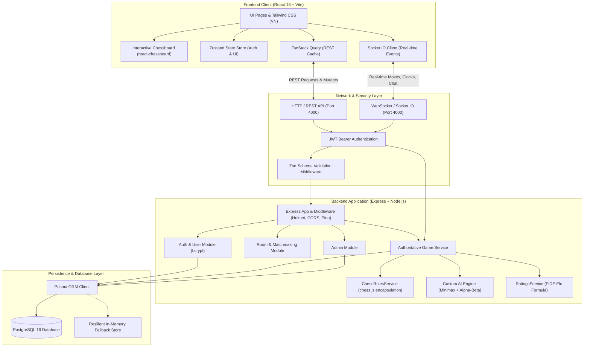
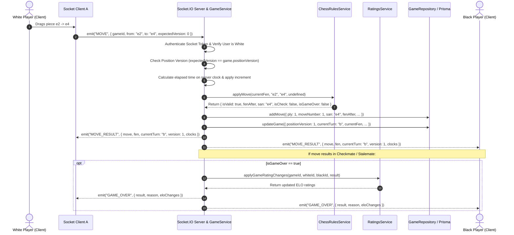
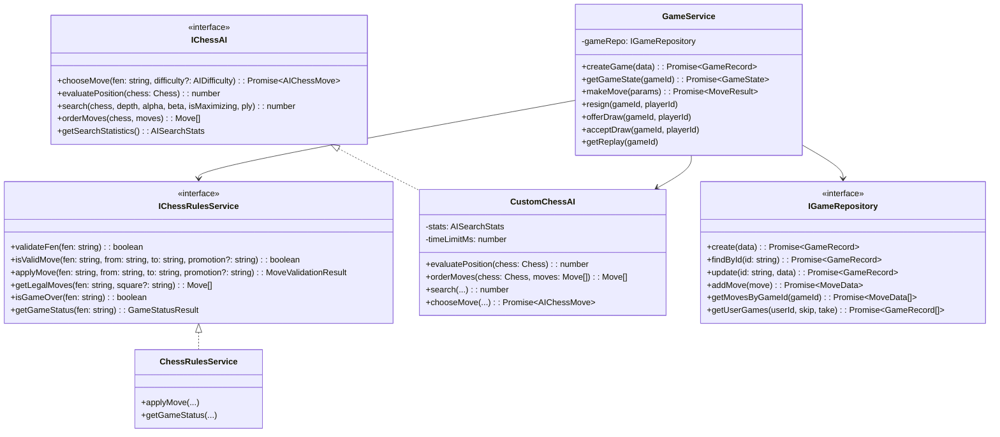

# System Architecture Document - Online Chess Platform

## 1. Architectural Overview

The Online Chess Platform is architected as a modular monorepo adhering to clean Client-Server separation and Domain-Driven Design (DDD) principles. The architecture partitions responsibilities across three discrete layers:
1. **Frontend Application (`apps/web`)**: A single-page application built on React 18, Vite, React Router, Tailwind CSS, TanStack Query, and Zustand, rendering Vietnamese-localized UI components.
2. **Backend Server (`apps/server`)**: A Node.js and Express RESTful service coupled with an authenticated Socket.IO WebSocket server, structured into modular feature services (Auth, Users, Rooms, Games, Chess, AI, Ratings, Admin).
3. **Shared Contract Library (`packages/shared`)**: Shared TypeScript types, Zod schemas, constants, and Socket.IO event definitions consumed by both client and server to guarantee type safety and schema consistency.

---

## 2. Sequence Diagram: Authoritative Chess Move Lifecycle

The sequence below illustrates the strict server-authoritative move validation workflow, ensuring that no client can unilaterally alter the board, clock, or game outcome.

---

## 3. High-Level Class & Interface Diagram

