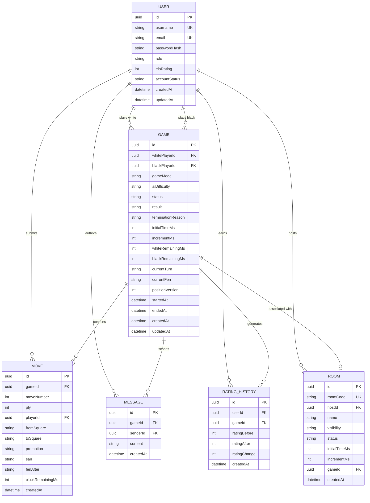

# Database Design & Persistence Specification

## 1. Entity-Relationship Diagram (ERD)

The database schema is implemented with **PostgreSQL 16** using **Prisma ORM**. The schema is normalized into 6 primary entities ensuring referential integrity, cascading deletions where appropriate, and indexed fields for query performance.

---

## 2. Table Specifications

### 2.1 `User`
Stores authenticated player accounts, credentials, access tiers, and current ratings.
- `id` (UUID, Primary Key)
- `username` (VARCHAR(50), Unique, Indexed)
- `email` (VARCHAR(255), Unique, Indexed)
- `passwordHash` (TEXT): bcrypt hash string with salt.
- `role` (ENUM: `GUEST`, `PLAYER`, `ADMIN`): Default `PLAYER`.
- `eloRating` (INT): Default `1200`, indexed descending for fast leaderboard queries.
- `accountStatus` (ENUM: `ACTIVE`, `RESTRICTED`, `SUSPENDED`): Default `ACTIVE`.
- `createdAt` / `updatedAt` (TIMESTAMPTZ)

### 2.2 `Game`
The central state entity recording live and historical chess matches.
- `id` (UUID, Primary Key)
- `whitePlayerId` (UUID, Foreign Key $\to$ User.id, Cascade Delete)
- `blackPlayerId` (UUID, Foreign Key $\to$ User.id, Nullable for AI games)
- `gameMode` (ENUM: `PVP`, `AI`)
- `aiDifficulty` (VARCHAR(20), Nullable: `EASY`, `MEDIUM`, `HARD`)
- `status` (ENUM: `WAITING`, `IN_PROGRESS`, `COMPLETED`, `ABANDONED`)
- `result` (ENUM: `WHITE_WON`, `BLACK_WON`, `DRAW`, Nullable)
- `terminationReason` (ENUM: `CHECKMATE`, `STALEMATE`, `TIMEOUT`, `RESIGNATION`, `THREEFOLD_REPETITION`, `FIFTY_MOVE_RULE`, `INSUFFICIENT_MATERIAL`, `MUTUAL_AGREEMENT`, `ABANDONED`)
- `initialTimeMs` / `incrementMs` (INT)
- `whiteRemainingMs` / `blackRemainingMs` (INT)
- `currentTurn` (CHAR(1): `'w'` or `'b'`)
- `currentFen` (TEXT): Standard Forsyth-Edwards Notation string.
- `positionVersion` (INT): Concurrency control version incremented on each valid move.
- `startedAt` / `endedAt` (TIMESTAMPTZ, Nullable)

### 2.3 `Move`
Full chronological move audit trail, preserving SAN notation and ply for draw detection and step-by-step game replay.
- `id` (UUID, Primary Key)
- `gameId` (UUID, Foreign Key $\to$ Game.id, Cascade Delete)
- `moveNumber` (INT): e.g. 1, 2, 3...
- `ply` (INT): Half-move index (1 for 1. e4, 2 for 1... e5)
- `playerId` (UUID, Foreign Key $\to$ User.id, Nullable)
- `fromSquare` (CHAR(2)): e.g. "e2"
- `toSquare` (CHAR(2)): e.g. "e4"
- `promotion` (CHAR(1), Nullable): 'q', 'r', 'b', 'n'
- `san` (VARCHAR(15)): Standard Algebraic Notation (e.g. "Nf3", "O-O", "Qxf7#")
- `fenAfter` (TEXT): Full FEN after move execution
- `clockRemainingMs` (INT, Nullable)

### 2.4 `Message`
Scopes chat conversations to specific games.
- `id` (UUID, Primary Key)
- `gameId` (UUID, Foreign Key $\to$ Game.id)
- `senderId` (UUID, Foreign Key $\to$ User.id)
- `content` (VARCHAR(500))
- `createdAt` (TIMESTAMPTZ)

### 2.5 `RatingHistory`
Maintains an immutable historical ledger of ELO rating adjustments following each rated competitive match.
- `id` (UUID, Primary Key)
- `userId` (UUID, Foreign Key $\to$ User.id)
- `gameId` (UUID, Foreign Key $\to$ Game.id)
- `ratingBefore` (INT)
- `ratingAfter` (INT)
- `ratingChange` (INT)
- `createdAt` (TIMESTAMPTZ)

### 2.6 `Room`
Manages virtual lobby rooms prior to and during gameplay.
- `id` (UUID, Primary Key)
- `roomCode` (VARCHAR(10), Unique, Indexed)
- `hostId` (UUID, Foreign Key $\to$ User.id)
- `name` (VARCHAR(100))
- `visibility` (ENUM: `PUBLIC`, `PRIVATE`)
- `status` (ENUM: `WAITING`, `READY`, `IN_PROGRESS`, `FINISHED`, `CANCELLED`)
- `initialTimeMs` / `incrementMs` (INT)
- `gameId` (UUID, Nullable, Unique)

---

## 3. Persistent vs. In-Memory State Strategy

| State Aspect | Storage Tier | Justification |
| :--- | :--- | :--- |
| Registered User Accounts | PostgreSQL / Prisma | Must persist across restarts with unique constraints |
| Completed Games & Moves | PostgreSQL / Prisma | Required for historical review, replay analysis, and audits |
| ELO Rating History | PostgreSQL / Prisma | Required for rating transparency and leaderboard accuracy |
| Active Matchmaking Queue | Server RAM | Transient in-memory queue; cleared on match pairing or cancel |
| Active Socket Connections | Server RAM | Ephemeral connection maps keyed by `socket.id` and `userId` |
| Sub-second Clock Decays | Server RAM + Event Loop | High-frequency decays updated periodically; persisted upon moves |
