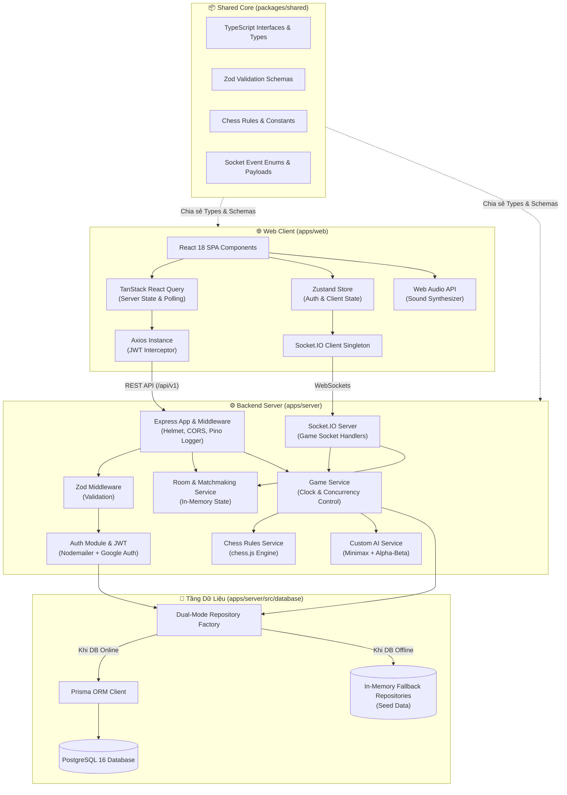
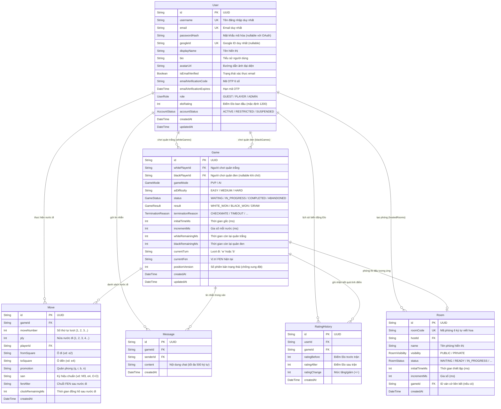
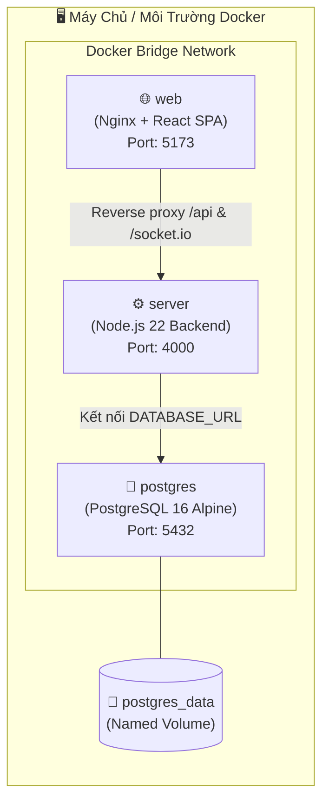
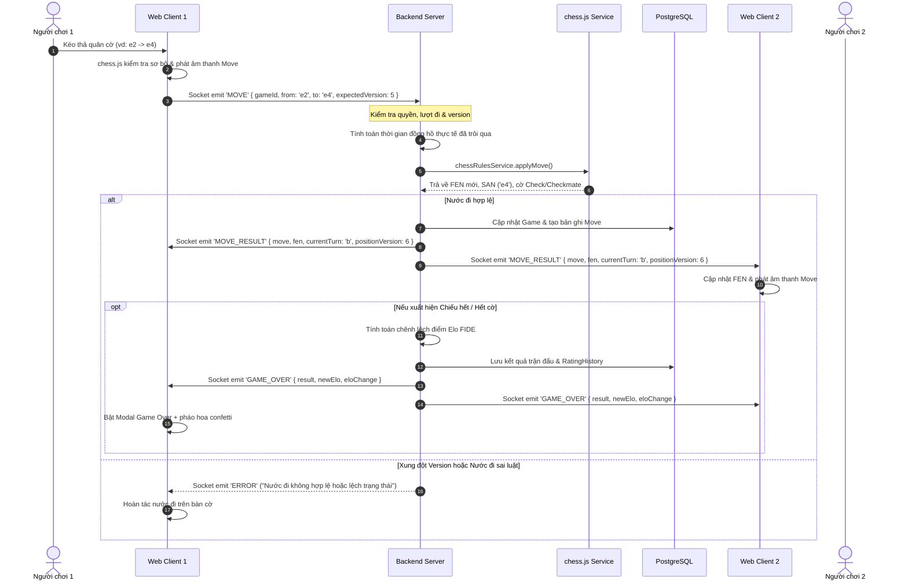

# 📋 Tài Liệu Phân Tích Toàn Diện Dự Án Online Chess Platform

> [!NOTE]
> Tài liệu này phân tích chi tiết toàn bộ kiến trúc, công nghệ sử dụng, cấu trúc thư mục, thiết kế hệ thống và luồng hoạt động thực tế của nền tảng **Online Chess** (hệ thống chơi cờ vua trực tuyến thời gian thực với công cụ AI Minimax tự xây dựng).

---

## 📑 Mục Lục

1. [Tổng Quan Dự Án](#1-tổng-quan-dự-án)
2. [Kiến Trúc Tổng Thể](#2-kiến-trúc-tổng-thể)
3. [Bảng Tổng Hợp Công Nghệ](#3-bảng-tổng-hợp-công-nghệ)
4. [Cấu Trúc Thư Mục Monorepo](#4-cấu-trúc-thư-mục-monorepo)
5. [Chi Tiết Gói Dùng Chung (`packages/shared`)](#5-chi-tiết-gói-dùng-chung-packagesshared)
6. [Chi Tiết Backend Server (`apps/server`)](#6-chi-tiết-backend-server-appsserver)
7. [Chi Tiết Frontend Web (`apps/web`)](#7-chi-tiết-frontend-web-appsweb)
8. [Thiết Kế Cơ Sở Dữ Liệu (PostgreSQL & Prisma)](#8-thiết-kế-cơ-sở-dữ-liệu-postgresql--prisma)
9. [Hệ Thống Real-time (Socket.IO)](#9-hệ-thống-real-time-socketio)
10. [Công Cụ Cờ Vua & AI Engine (Minimax)](#10-công-cụ-cờ-vua--ai-engine-minimax)
11. [Cơ Chế Xác Thực & Bảo Mật](#11-cơ-chế-xác-thực--bảo-mật)
12. [Hạ Tầng, Container & Triển Khai (Docker Compose)](#12-hạ-tầng-container--triển-khai-docker-compose)
13. [Các Luồng Nghiệp Vụ Chính](#13-các-luồng-nghiệp-vụ-chính)
14. [Đánh Giá Điểm Mạnh & Tiềm Năng Nâng Cấp](#14-đánh-giá-điểm-mạnh--tiềm-năng-nâng-cấp)

---

## 1. Tổng Quan Dự Án

| Thuộc tính | Chi tiết |
|---|---|
| **Tên dự án** | `online-chess` |
| **Phiên bản** | 1.0.0 |
| **Mục tiêu** | Nền tảng cờ vua trực tuyến chuẩn FIDE, hỗ trợ thi đấu PvP thời gian thực, ghép cặp tự động, chơi với AI tùy chỉnh và quản trị người dùng. |
| **Mô hình kiến trúc** | Monorepo (npm workspaces) |
| **Ngôn ngữ chủ đạo** | TypeScript (Full-stack: Shared, Server, Client) |
| **Cổng mặc định** | Server: `4000` (`/api/v1`) \| Client (Vite): `5173` \| PostgreSQL: `5432` |

### Các Tính Năng Trọng Tâm
- ♟️ **Thi đấu cờ vua PvP thời gian thực**: Đồng bộ nước đi, thời gian đồng hồ từng giây, phát hiện chiếu, chiếu hết, hòa cờ chuẩn FIDE.
- 🤖 **Chế độ đấu AI độc lập**: Tự xây dựng động cơ tìm kiếm Minimax kết hợp tỉa nhánh Alpha-Beta và bảng giá trị vị trí ô cờ (Piece-Square Tables), không phụ thuộc Stockfish ngoài.
- ⏱️ **Kiểm soát thời gian phong phú**: Bullet (1 phút), Blitz (3p, 5p), Rapid (10p, 15p + 10s increment).
- 🔄 **Kiểm soát xung đột lạc quan (Optimistic Concurrency)**: Sử dụng `positionVersion` / `expectedVersion` chống lệch trạng thái giữa hai đối thủ.
- 🏆 **Hệ thống tính điểm Elo chuẩn FIDE**: Hệ số K động (K=32 cho người mới, K=16 cho rating ≥ 2400), ghi nhận lịch sử biến động điểm sau mỗi trận.
- 🚪 **Hệ thống phòng thi đấu & Ghép cặp (Matchmaking)**: Tạo phòng công khai/riêng tư với mã phòng (`roomCode`), hàng đợi ghép cặp tự động.
- 💬 **Trò chuyện trực tiếp (In-game Chat)**: Nhắn tin trong phòng chơi với bộ lọc độ dài và chống spam.
- 📜 **Xem lại ván cờ (Game Replay)**: Xem lại chi tiết từng nước đi, tái tạo trạng thái FEN qua từng ply.
- 👤 **Hồ sơ & Quản trị**: Đăng nhập mật khẩu/Google OAuth, xác minh email qua mã OTP 6 số, trang quản trị dành riêng cho vai trò `ADMIN`.

---

## 2. Kiến Trúc Tổng Thể

Hệ thống được thiết kế theo kiến trúc hướng module phân lớp, đảm bảo tính phân tách trách nhiệm (Separation of Concerns) và chia sẻ mã nguồn chặt chẽ.



---

## 3. Bảng Tổng Hợp Công Nghệ

### 3.1 Backend (`apps/server`)
- **Runtime**: Node.js (hỗ trợ v20 - v22)
- **Framework**: Express.js 4.19
- **Giao thức thời gian thực**: Socket.IO 4.7.5
- **ORM / Database**: Prisma ORM 5.14.0 kết hợp PostgreSQL 16
- **Xác thực & Mã hóa**: JWT (`jsonwebtoken` 9.0), `bcryptjs` 2.4, `google-auth-library` 11.3 (xác thực token Google ID/Access)
- **Email**: `nodemailer` 10.3 (hỗ trợ SMTP thực tế hoặc chế độ log console khi dev)
- **Kiểm thử quy tắc cờ vua**: `chess.js` 1.0.0-beta.6 (server-authoritative rule verification)
- **Logger**: `pino` 9.1 + `pino-pretty` 11.1
- **Bảo mật**: `helmet` 7.1, `cors` 2.8, rate limiting
- **Validation**: `zod` 3.23 (schema validation đầu vào)
- **Thực thi & Test**: `tsx` 4.11, `vitest` 1.6, `supertest` 7.0

### 3.2 Frontend (`apps/web`)
- **Nền tảng**: React 18.3 + TypeScript 5.4 + Vite 5.2
- **Định tuyến (Routing)**: `react-router-dom` 6.23
- **Quản lý trạng thái (State Management)**:
  - `zustand` 4.5: Trạng thái phiên đăng nhập người dùng (token, user profile) lưu vào `localStorage`.
  - `@tanstack/react-query` 5.40: Quản lý cache và đồng bộ dữ liệu từ server (danh sách phòng, leaderboard, lịch sử, profile).
- **Giao diện & Styling**:
  - `tailwindcss` 3.4 với bộ biến màu chuyên dụng cho cờ vua (`chess.boardLight`, `chess.boardDark`, `chess.surface`,...).
  - Biểu tượng: `lucide-react` 0.378.
  - Hiệu ứng chiến thắng: `canvas-confetti` 1.9.
- **Bàn cờ & Logic cờ phía Client**:
  - `react-chessboard` 4.7.2: Render bàn cờ tương tác kéo-thả và click-to-move.
  - `chess.js` 1.0.0-beta.6: Kiểm tra trước tính hợp lệ của nước đi trên máy khách (Optimistic/Client validation).
- **Âm thanh**: Web Audio API tổng hợp âm thanh bằng code (`lib/sound.ts`), không cần tải file MP3/WAV ngoài (move, capture, check, gameover).
- **Form & Validation**: `react-hook-form` 7.51 + `@hookform/resolvers` 3.4 kết hợp Zod schema từ `@online-chess/shared`.

### 3.3 Gói Dùng Chung (`packages/shared`)
- **TypeScript** 5.4 xuất mã chuẩn CommonJS/Declaration d.ts.
- **Zod** 3.23: Cung cấp toàn bộ schema xác thực dùng chung giữa backend và frontend, đảm bảo phản hồi lỗi tiếng Việt đồng nhất.

---

## 4. Cấu Trúc Thư Mục Monorepo

```
online-chess/
├── 📄 package.json              # Monorepo workspaces config (packages/*, apps/*)
├── 📄 tsconfig.base.json        # TypeScript base config (ES2022, strict mode)
├── 📄 docker-compose.yml        # Docker compose quản lý Postgres, Server, Web
├── 📄 .env.example              # Khung cấu hình các biến môi trường
├── 📄 AGENTS.md                 # Quy chuẩn thiết kế giao diện & phong cách kỹ thuật
├── 📄 README.md                 # Giới thiệu dự án, hướng dẫn cài đặt & khởi chạy
│
├── 📁 packages/
│   └── 📁 shared/               # @online-chess/shared (Types, Schemas, Constants)
│       ├── 📄 package.json
│       ├── 📄 tsconfig.json
│       └── 📁 src/
│           ├── 📄 index.ts      # Re-export toàn bộ
│           ├── 📁 types/        # user, game, room, socket, ai, chat, leaderboard
│           ├── 📁 schemas/      # auth, game, room, chat (Zod schemas)
│           └── 📁 constants/    # chess.ts (FEN, Time controls, Elo config, AI levels)
│
├── 📁 apps/
│   ├── 📁 server/               # @online-chess/server (Backend Node.js API & Sockets)
│   │   ├── 📄 package.json
│   │   ├── 📄 tsconfig.json
│   │   ├── 📁 prisma/
│   │   │   └── 📄 schema.prisma # Mô hình 6 bảng dữ liệu PostgreSQL
│   │   └── 📁 src/
│   │       ├── 📄 server.ts     # Khởi tạo HTTP server & Socket.IO, graceful shutdown
│   │       ├── 📄 app.ts        # Cấu hình Express app, middleware pipeline, route binding
│   │       ├── 📁 config/       # env.ts (Zod env parser), logger.ts (Pino)
│   │       ├── 📁 database/     # prisma.ts (kiểm tra kết nối DB)
│   │       ├── 📁 middleware/   # auth.ts, errorHandler.ts, requestLogger.ts, validate.ts
│   │       ├── 📁 modules/      # Kiến trúc module hoá tính năng:
│   │       │   ├── 📁 admin/        # Quản lý người dùng, xem thống kê hệ thống
│   │       │   ├── 📁 ai/           # chessAi.service.ts (Thuật toán Minimax + Alpha-Beta)
│   │       │   ├── 📁 auth/         # Đăng ký, đăng nhập, Google OAuth, gửi OTP email
│   │       │   ├── 📁 chat/         # Quản lý tin nhắn trong ván cờ
│   │       │   ├── 📁 chess/        # chessRules.service.ts (Kiểm định luật bằng chess.js)
│   │       │   ├── 📁 games/        # Điều phối ván cờ, đồng hồ, lưu lịch sử, Replay
│   │       │   ├── 📁 matchmaking/  # Hàng đợi ghép cặp người chơi tự động
│   │       │   ├── 📁 ratings/      # Thuật toán tính điểm Elo FIDE & BXH
│   │       │   ├── 📁 rooms/        # Tạo phòng, vào phòng, thoát phòng
│   │       │   └── 📁 users/        # Thông tin cá nhân, cập nhật avatar, thống kê
│   │       ├── 📁 sockets/      # gameSocket.ts (xử lý Socket.IO), socketAuth.ts
│   │       └── 📁 utils/        # mailer.ts (gửi mã xác nhận qua email)
│   │
│   └── 📁 web/                  # @online-chess/web (Frontend React 18 + Vite)
│       ├── 📄 package.json
│       ├── 📄 vite.config.ts    # Cấu hình alias `@`, proxy dev `/api` & `/socket.io`
│       ├── 📄 tailwind.config.js# Bộ token giao diện cờ vua, bóng đổ, typography
│       ├── 📄 index.html
│       └── 📁 src/
│           ├── 📄 main.tsx      # React DOM entry point, QueryClientProvider
│           ├── 📄 index.css     # Định nghĩa biến CSS, typography, scrollbar
│           ├── 📁 app/
│           │   └── 📄 App.tsx   # Định tuyến (Routes), thanh điều hướng, footer
│           ├── 📁 components/   # auth/GoogleLoginButton.tsx
│           ├── 📁 features/     # Tổ chức mã nguồn theo chức năng:
│           │   ├── 📁 admin/        # Trang quản trị dành cho Admin
│           │   ├── 📁 auth/         # Đăng nhập, đăng ký, xác thực mã email
│           │   ├── 📁 game/         # GamePage.tsx, AIGamePage.tsx, GameReplayPage.tsx
│           │   ├── 📁 leaderboard/ # Bảng xếp hạng Elo phân trang
│           │   ├── 📁 lobby/        # Danh sách phòng, tạo phòng, tìm trận
│           │   └── 📁 profile/      # Quản lý thông tin tài khoản & đổi mật khẩu
│           ├── 📁 lib/          # sound.ts (Bộ phát âm thanh Web Audio API)
│           ├── 📁 services/     # api.ts (Axios + interceptor), socket.ts (Socket.IO client)
│           └── 📁 stores/       # authStore.ts (Zustand)
│
└── 📁 docs/                     # Tài liệu thiết kế hệ thống chi tiết
```

---

## 5. Chi Tiết Gói Dùng Chung (`packages/shared`)

Gói `@online-chess/shared` đóng vai trò là "Single Source of Truth" (Nguồn chân lý duy nhất) cho toàn bộ hệ thống:

### 5.1 Các Kiểu Dữ Liệu Chính
- **Game & Move**:
  - `GameMode`: `'PVP' | 'AI'`
  - `GameStatusType`: `'WAITING' | 'IN_PROGRESS' | 'COMPLETED' | 'ABANDONED'`
  - `GameResultType`: `'WHITE_WON' | 'BLACK_WON' | 'DRAW'`
  - `TerminationReasonType`: `CHECKMATE`, `STALEMATE`, `TIMEOUT`, `RESIGNATION`, `THREEFOLD_REPETITION`, `FIFTY_MOVE_RULE`, `INSUFFICIENT_MATERIAL`, `MUTUAL_AGREEMENT`, `ABANDONED`
  - `GameState`: Chứa toàn bộ thông tin hai đấu thủ, FEN hiện tại, lượt đi, đồng hồ còn lại (`whiteRemainingMs`, `blackRemainingMs`), lịch sử nước đi, và đặc biệt là `positionVersion`.
  - `MoveSubmission`: `{ gameId, from, to, promotion?, expectedVersion }`
- **Room**: `RoomVisibility` (`PUBLIC` / `PRIVATE`), `RoomStatusType`, `RoomPlayer`, `RoomData`.
- **AI**: `AIDifficulty` (`EASY`, `MEDIUM`, `HARD`), `AISearchStats`, `AIChessMove`.
- **Socket Events & Payloads**: Khai báo danh mục `SOCKET_EVENTS` và payload tương ứng cho từng sự kiện.

### 5.2 Schemas Kiểm Định Đầu Vào (Zod)
- `registerSchema`: Username từ 3-20 ký tự, email hợp lệ, mật khẩu tối thiểu 6 ký tự.
- `loginSchema`: Hỗ trợ đăng nhập linh hoạt bằng `usernameOrEmail` + `password`.
- `makeMoveSchema`: Kiểm tra regex tọa độ ô cờ (`[a-h][1-8]`), quân phong cấp (`q`, `r`, `b`, `n`), mã trận và version đồng bộ.
- `createAiGameSchema`: Cấu hình độ khó (`EASY`/`MEDIUM`/`HARD`), thời gian bàn cờ (1 phút đến 1 giờ), gia số (0-60s), màu quân chọn trước.
- `createRoomSchema` & `joinRoomSchema`: Tạo phòng tùy chỉnh thời gian hoặc tham gia qua mã phòng `roomCode`.

---

## 6. Chi Tiết Backend Server (`apps/server`)

### 6.1 Luồng Xử Lý Middleware

```
Client Request
      │
      ▼
┌──────────────┐
│   helmet()   │  ──> Thêm các HTTP Security Headers
└──────┬───────┘
       ▼
┌──────────────┐
│    cors()    │  ──> Cấu hình origin an toàn cho phép từ Frontend
└──────┬───────┘
       ▼
┌──────────────┐
│ requestLogger│  ──> Ghi log method, url, mã trạng thái và thời gian qua Pino
└──────┬───────┘
       ▼
┌──────────────┐
│ express.json │  ──> Parse body JSON
└──────┬───────┘
       ▼
┌──────────────┐
│ validate(...)│  ──> Kiểm tra Zod schema đầu vào (nếu route yêu cầu)
└──────┬───────┘
       ▼
┌──────────────┐
│authenticate /│  ──> Giải mã JWT token, kiểm tra vai trò người dùng
│ requireRole  │
└──────┬───────┘
       ▼
┌──────────────┐
│ Route Handler│  ──> Thực thi logic nghiệp vụ Controller / Service
└──────┬───────┘
       ▼
┌──────────────┐
│ errorHandler │  ──> Bắt lỗi tập trung (ZodError, AppError, 500)
└──────────────┘
```

### 6.2 Mô Hình Dual-Mode Repository Độc Đáo
Server triển khai cơ chế **Dual-Mode Repository Factory** (`getUserRepository()`, `getGameRepository()`):
- Khi khởi động, hàm `checkDatabaseConnection()` kiểm tra kết nối tới cơ sở dữ liệu PostgreSQL.
- **Nếu kết nối thành công**: Ứng dụng kích hoạt `PrismaUserRepository` và `PrismaGameRepository`, lưu trữ bền vững vào PostgreSQL.
- **Nếu cơ sở dữ liệu không khả dụng (Offline/Dev)**: Hệ thống tự động chuyển sang `MemoryUserRepository` và `MemoryGameRepository` (được nạp sẵn 4 tài khoản mẫu bao gồm cả tài khoản `ADMIN`), giúp ứng dụng vẫn có thể phát triển, chạy thử và test mà không bị gián đoạn.
- Riêng hệ thống **Room** và **Matchmaking Queue** được lưu giữ trong bộ nhớ (In-memory) của server để tối đa hóa tốc độ phản hồi thời gian thực.

---

## 7. Chi Tiết Frontend Web (`apps/web`)

### 7.1 Phân Cấp Các Tính Năng (Feature-Driven Architecture)

- **Landing Page (`/`)**: Trình bày giao diện trực quan, bảng cờ demo sống động, các chế độ thi đấu chính.
- **Authentication (`/login`, `/register`, `/verify-email`)**:
  - Tích hợp biểu mẫu với `react-hook-form` và kiểm định qua `zod`.
  - Hỗ trợ Google Sign-In qua component `GoogleLoginButton` (Google Identity Services SDK).
  - Luồng nhập mã xác thực OTP 6 số gửi qua email.
- **Lobby (`/lobby`)**:
  - Hàng đợi tìm trận ngẫu nhiên (Matchmaking) với đồng hồ đếm giây chờ.
  - Tạo phòng chơi mới với thiết lập thời gian phong phú.
  - Tham gia phòng nhanh bằng mã `roomCode`.
  - Lưới danh sách phòng công khai được tự động làm mới qua polling React Query (chu kỳ 4 giây).
- **Game Trực Tiếp (`/game/:id`)**:
  - Bàn cờ trung tâm dựa trên `react-chessboard`.
  - Đồng hồ thi đấu đếm ngược (đổi màu cảnh báo đỏ nhấp nháy khi thời gian dưới 30 giây).
  - Bảng lịch sử nước đi dạng cột đôi hiển thị chỉ số ply chuẩn quốc tế.
  - Cửa sổ chat trực tiếp trong ván cờ.
  - Thanh công cụ hành động: Xoay bàn cờ, bật/tắt âm thanh, cầu hòa, đầu hàng.
  - Modal chiến thắng kèm hiệu ứng pháo hoa rực rỡ (`canvas-confetti`) và bảng thống kê thay đổi điểm Elo.
- **Đấu Với AI (`/ai`)**:
  - Độc lập cấu hình độ khó, lựa chọn màu quân.
  - Bảng thống kê chi tiết của động cơ AI: Độ sâu tìm kiếm, số nút đã duyệt, số nút đã cắt tỉa, điểm đánh giá vị thế bàn cờ (centipawns), thời gian tính toán.
  - Gợi ý nước đi hợp lệ với chỉ dẫn đồ họa (chấm tròn xanh) và ô bị ăn (vòng tròn đỏ).
- **Xem Lại Ván Đấu (`/history`)**: Cho phép duyệt từng nước đi (`Previous`, `Next`, `Start`, `End`) dựa trên dữ liệu FEN và SAN của ván đã lưu.
- **Bảng Xếp Hạng (`/leaderboard`)**: Hiển thị bảng tổng sắp người chơi phân trang với huy chương vinh danh Top 1, 2, 3 và tỉ lệ thắng (Win Rate).
- **Quản Trị (`/admin`)**: Dành riêng cho `ADMIN`, cho phép tra cứu người dùng, khóa/mở khóa tài khoản (`ACTIVE`, `RESTRICTED`, `SUSPENDED`) và giám sát tài nguyên bộ nhớ hệ thống.

### 7.2 Hệ Thống Âm Thanh Tổng Hợp Thuần Code (`lib/sound.ts`)
Ứng dụng sử dụng **Web Audio API** để tạo trực tiếp các dạng sóng âm thanh mà không cần tải tài nguyên âm thanh từ bên ngoài:
- **Nước đi thông thường (Move)**: Sóng hình sin (Sine wave) tần số trượt từ 320Hz xuống 180Hz (thời lượng 90ms).
- **Nước ăn quân (Capture)**: Sóng tam giác (Triangle wave) tần số từ 360Hz xuống 140Hz (110ms).
- **Chiếu tướng (Check)**: Sóng hình sin tăng vọt từ 650Hz lên 850Hz (220ms).
- **Kết thúc ván (Game Over)**: Sóng tam giác trầm từ 440Hz xuống 220Hz (350ms).

---

## 8. Thiết Kế Cơ Sở Dữ Liệu (PostgreSQL & Prisma)

Cơ sở dữ liệu được quản lý bởi **Prisma ORM**, gồm 6 bảng dữ liệu liên kết chặt chẽ:



---

## 9. Hệ Thống Real-time (Socket.IO)

Hệ thống WebSocket sử dụng thư viện `socket.io` với middleware xác thực token JWT ngay từ bước bắt tay kết nối (`handshake.auth.token`).

### 9.1 Danh Mục Sự Kiện WebSocket (Type-Safe)

| Sự Kiện | Chiều Gửi | Yêu Cầu Auth | Chức Năng |
|---|---|---|---|
| `JOIN_ROOM` | Client ➔ Server | Có | Vào phòng qua `roomId` hoặc `roomCode`. Server gửi lại `ROOM_UPDATED` & `GAME_STATE`. |
| `LEAVE_ROOM` | Client ➔ Server | Có | Rời khỏi phòng hiện tại. |
| `REQUEST_GAME_STATE` | Client ➔ Server | Không | Lấy toàn bộ trạng thái ván cờ và tin nhắn (dành cho người xem hoặc khi tải lại trang). |
| `MOVE` | Client ➔ Server | Có | Gửi nước đi kèm `expectedVersion`. Server kiểm định và broadcast `MOVE_RESULT`. |
| `CHAT` | Client ➔ Server | Có | Gửi tin nhắn, server broadcast `CHAT_MESSAGE` tới các người xem/chơi trong phòng. |
| `RESIGN` | Client ➔ Server | Có | Người chơi xin đầu hàng. Server kết thúc trận và broadcast `GAME_OVER`. |
| `DRAW_OFFER` | Client ➔ Server | Có | Gửi lời mời hòa. Server chuyển tiếp sự kiện `DRAW_OFFERED` cho đối thủ. |
| `DRAW_ACCEPT` | Client ➔ Server | Có | Chấp nhận hòa. Server ghi nhận kết quả hòa (`MUTUAL_AGREEMENT`) và phát `GAME_OVER`. |
| `DRAW_REJECT` | Client ➔ Server | Không | Từ chối hòa. Server gửi `DRAW_REJECTED` báo cho đối thủ. |
| `RECONNECT` | Client ➔ Server | Không | Kết nối lại vào ván đấu, server gửi lại trạng thái và thông báo `PLAYER_RECONNECTED`. |
| `MATCHMAKING_JOIN` | Client ➔ Server | Có | Tham gia hàng đợi tìm trận theo xếp hạng. |
| `MATCHMAKING_CANCEL`| Client ➔ Server | Có | Hủy yêu cầu tìm trận. |

### 9.2 Cơ Chế Kiểm Soát Phiên Bản (Optimistic Concurrency Control)
Để ngăn ngừa tình trạng mất đồng bộ khi hai đấu thủ đánh cờ trên kết nối mạng có độ trễ cao:
1. Mỗi khi bàn cờ thay đổi trạng thái, giá trị `positionVersion` tăng thêm 1 đơn vị.
2. Phía máy khách khi gửi nước đi phải kèm theo `expectedVersion`.
3. Server so sánh: nếu `expectedVersion !== game.positionVersion`, yêu cầu sẽ bị từ chối với lỗi **409 Conflict**, buộc client phải yêu cầu cập nhật lại trạng thái bàn cờ mới nhất trước khi đi tiếp.

---

## 10. Công Cụ Cờ Vua & AI Engine (Minimax)

### 10.1 Động Cơ AI Tự Xây Dựng (`chessAi.service.ts`)
Thay vì tích hợp Stockfish bên ngoài, dự án tự hiện thực một động cơ cờ vua chuẩn giải thuật:
- **Thuật toán cốt lõi**: **Minimax** kết hợp kỹ thuật **Tỉa nhánh Alpha-Beta** (Alpha-Beta Pruning) giúp loại bỏ sớm các nhánh cây tìm kiếm không đem lại kết quả tối ưu.
- **Sắp xếp thứ tự nước đi (Move Ordering)**:
  - Áp dụng nguyên lý **MVV-LVA (Most Valuable Victim - Least Valuable Attacker)**: Ưu tiên phân tích các nước ăn quân có giá trị cao trước (ví dụ: Tốt ăn Hậu được duyệt trước Xe ăn Tốt).
  - Ưu tiên các nước phong cấp quân (+800 điểm) và các nước chiếu tướng (+50 điểm) để tối đa hóa khả năng cắt tỉa nhánh.
- **Hạn mức thời gian bảo vệ (Time Guard)**: Kiểm tra chu kỳ mỗi 1.000 nút tính toán; nếu vượt quá thời gian tối đa cho phép của độ khó, động cơ dừng tìm kiếm sâu và trả về nước đi tốt nhất hiện có.

### 10.2 Hàm Đánh Giá Vị Thế Bàn Cờ (Heuristic Evaluation)
Điểm số bàn cờ được tính theo đơn vị **Centipawns** (1 Tốt = 100 điểm):
$$\text{Score} = \text{Score}_{\text{white}} - \text{Score}_{\text{black}}$$
Bao gồm các thành phần:
1. **Giá trị vật chất (Material Values)**:
   - Tốt (Pawn): 100
   - Mã (Knight): 320
   - Tượng (Bishop): 330
   - Xe (Rook): 500
   - Hậu (Queen): 900
   - Vua (King): 20.000
2. **Bảng giá trị vị trí ô (Piece-Square Tables - PST)**: Thưởng điểm khi quân chiếm lĩnh các ô chiến lược (Tốt chiếm trung tâm, Mã hướng vào trung tâm, Vua ẩn nấp an toàn sau lá chắn Tốt ở trung cuộc).
3. **Hình thái Tốt (Pawn Structure)**: Trừ điểm khi xuất hiện Tốt chồng (-20 điểm cho mỗi Tốt thừa trên cùng một cột).
4. **Trạng thái chiếu (Check State)**: Trừ 40 điểm cho bên đang bị chiếu.

### 10.3 Các Cấp Độ Khó

| Cấp Độ | Độ Sâu (Depth) | Giới Hạn Thời Gian | Tỉ Lệ Đi Ngẫu Nhiên | Mô Tả |
|---|---|---|---|---|
| **EASY** | 1 | 1.000 ms | 35% | Nước đi ngẫu nhiên xen kẽ, phù hợp cho người mới làm quen |
| **MEDIUM** | 3 | 2.500 ms | 5% | Tính toán sâu 3 nước, biết tính toán cơ bản và khai thác sai lầm |
| **HARD** | 4 | 5.000 ms | 0% | Tìm kiếm triệt để ở độ sâu 4, tối ưu hóa toàn bộ các nước đi |

---

## 11. Cơ Chế Xác Thực & Bảo Mật

### 11.1 Đăng Ký & Xác Minh Email
1. Người dùng gửi yêu cầu đăng ký tài khoản.
2. Mật khẩu được băm bằng thuật toán `bcryptjs` với 10 vòng sinh muối (Salt rounds).
3. Tài khoản được khởi tạo với trạng thái `isEmailVerified: false`.
4. Hệ thống tạo mã OTP gồm 6 chữ số ngẫu nhiên với thời hạn hiệu lực 15 phút và gửi qua email bằng `Nodemailer`.
5. Người dùng nhập đúng mã OTP để kích hoạt tài khoản. Hệ thống kiểm tra chặt chẽ: người dùng chưa kích hoạt email sẽ không thể đăng nhập.

### 11.2 Đăng Nhập Google OAuth
Hệ thống hỗ trợ nhiều phương thức xác minh tài khoản Google linh hoạt:
- Xác minh `idToken` thông qua thư viện chính thức `google-auth-library`.
- Xác minh `accessToken` qua API userinfo của Google.
- Tự động liên kết Google ID với tài khoản đã tồn tại nếu trùng khớp email, hoặc khởi tạo tài khoản mới nếu chưa từng đăng ký.

### 11.3 Quản Lý Phân Quyền & Giám Sát Tài Khoản
- Hệ thống hỗ trợ 3 vai trò: `GUEST`, `PLAYER`, `ADMIN`.
- Middleware `requireRole('ADMIN')` bảo vệ nghiêm ngặt các API quản trị (`/api/v1/admin/*`).
- Tài khoản có trạng thái `SUSPENDED` sẽ bị chặn truy cập ngay lập tức từ tầng middleware xác thực.

---

## 12. Hạ Tầng, Container & Triển Khai (Docker Compose)

Dự án cung cấp tệp cấu hình `docker-compose.yml` chuẩn hóa, sẵn sàng triển khai môi trường khép kín:



### Các Dịch Vụ Trong `docker-compose.yml`
1. **`postgres`**: Image `postgres:16-alpine`, có cơ chế kiểm tra sức khỏe tự động (`pg_isready`), lưu trữ dữ liệu bền vững qua volume `postgres_data`.
2. **`server`**: Build từ mã nguồn `apps/server`, chỉ khởi động khi container cơ sở dữ liệu đạt trạng thái sẵn sàng (`service_healthy`).
3. **`web`**: Build ứng dụng React với Vite và phục vụ thông qua máy chủ web Nginx tốc độ cao.

---

## 13. Các Luồng Nghiệp Vụ Chính

### 13.1 Luồng Thực Hiện Nước Đi Trong Ván Cờ



### 13.2 Luồng Tính Điểm Xếp Hạng Elo Chuẩn FIDE
Khi trận đấu phân định thắng bại hoặc hòa, điểm Elo được tính tự động theo công thức:
1. **Tính điểm kỳ vọng (Expected Score)**:
   $$E_A = \frac{1}{1 + 10^{(R_B - R_A) / 400}}$$
2. **Xác định hệ số điều chỉnh K**:
   - Nếu người chơi có điểm $R < 2400$: $K = 32$.
   - Nếu người chơi đạt đẳng cấp cao $R \ge 2400$: $K = 16$.
3. **Tính điểm mới**:
   $$R_A' = R_A + K \times (S_A - E_A)$$
   *(với $S_A = 1$ khi thắng, $0.5$ khi hòa, $0$ khi thua)*
4. Điểm sàn tối thiểu luôn được giới hạn ở mức 100 điểm.

---

## 14. Đánh Giá Điểm Mạnh & Tiềm Năng Nâng Cấp

### 14.1 Điểm Mạnh Vượt Trội
- **Type-Safety Toàn Diện**: Việc sử dụng gói `@online-chess/shared` giúp toàn bộ dữ liệu từ DTO, Zod schema đến WebSocket payloads đồng bộ 100% giữa Client và Server.
- **Khả Năng Phục Hồi Cao (Fault Tolerance)**: Thiết kế Dual-mode Repository cho phép hệ thống tự thích nghi khi cơ sở dữ liệu gặp sự cố.
- **Tối Ưu Trải Nghiệm Người Dùng (UX)**: Giao diện Tailwind mượt mà, phản hồi âm thanh ngay lập tức qua Web Audio API không có độ trễ tải mạng, bàn cờ hỗ trợ cả click lẫn kéo-thả.
- **Chống Gian Lận & Lệch Trạng Thái**: Toàn bộ luật cờ và đồng hồ thi đấu do Server quyết định (Server-authoritative), kết hợp kiểm soát phiên bản `positionVersion`.

### 14.2 Đề Xuất Nâng Cấp Tương Lai
1. **Bộ Đệm Phân Tán (Redis Cache)**: Mặc dù hệ thống phòng và hàng đợi trong bộ nhớ hiện tại hoạt động rất nhanh, việc tích hợp Redis Adapter cho Socket.IO sẽ cho phép mở rộng quy mô hệ thống ngang (Horizontal Scaling) ra nhiều máy chủ backend.
2. **Khai Cuộc & Tàn Cuộc Cho AI**: Bổ sung cơ sở dữ liệu sách khai cuộc (Opening Book) và bảng thế càn tàn cuộc (Endgame Tablebases) để tăng sức mạnh cho AI mà không tốn thêm tài nguyên CPU.
3. **Chế Độ Giải Đấu (Tournament)**: Bổ sung chế độ thi đấu vòng tròn (Round Robin) hoặc loại trực tiếp (Swiss System).

---
*Tài liệu được tổng hợp và đối soát trực tiếp từ toàn bộ mã nguồn của dự án Online Chess Platform.*
