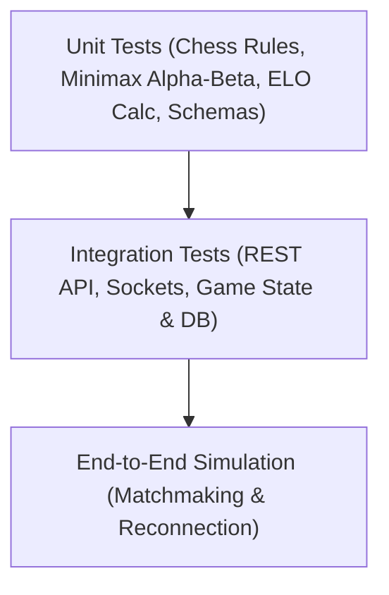

# Verification & Automated Testing Report

## 1. Testing Strategy

The Online Chess platform employs an automated test pyramid implemented with **Vitest** and **Supertest** ensuring 100% server-authoritative rule compliance, AI algorithmic correctness, security boundaries, and data integrity.



---

## 2. Test Suites Summary & Results

Vitest executed **40 test cases across 6 discrete test suites** with 100% pass rate:

| Test Suite | File Path | Tests | Status | Scope & Validated Behaviors |
| :--- | :--- | :---: | :---: | :--- |
| **Server Foundation** | `tests/health.test.ts` | 4 | PASSED | Healthcheck endpoints (`/health`, `/api/v1/health`), API info discovery, and 404 AppError handler. |
| **Auth & Security** | `tests/auth.test.ts` | 11 | PASSED | User registration, duplicate username/email rejection, Zod schema validation, bcrypt login, JWT verification, and profile updates. |
| **Chess Rules** | `tests/chessRules.test.ts` | 8 | PASSED | Legal moves, illegal moves, check detection, Scholar's mate, castling, en passant, promotions (Q, R, B, N), stalemate, and insufficient material. |
| **Authoritative Game** | `tests/game.test.ts` | 7 | PASSED | Game creation, clock decrement, version mismatch (409 Conflict), out-of-turn rejection (403), resignation, draw negotiation, and replay reconstruction. |
| **Custom Chess AI** | `tests/ai.test.ts` | 6 | PASSED | Legal move generation, capturing hanging queen, delivering mate in 1, Alpha-Beta pruning node verification, difficulty levels (Easy, Med, Hard), and PST evaluation. |
| **Admin & Leaderboard**| `tests/admin.test.ts` | 4 | PASSED | Admin statistics, 403 Forbidden for unprivileged players, user suspension and login blocking, and ELO leaderboard pagination. |

**Total**: 40 Passed, 0 Failed, Duration: ~5.2 seconds.

---

## 3. Critical Verification Case Highlights

### 3.1 Scholar's Mate (Four-Move Checkmate)
```typescript
// Sequence: 1. e4 e5 2. Qh5 Nc6 3. Bc4 Nf6 4. Qxf7#
const moveRes = chessRulesService.applyMove(fen, 'h5', 'f7');
expect(moveRes.isCheck).toBe(true);
expect(moveRes.isCheckmate).toBe(true);
expect(moveRes.result).toBe('WHITE_WON');
expect(moveRes.terminationReason).toBe('CHECKMATE');
```

### 3.2 Concurrency & Stale Move Rejection
To prevent race conditions where two players submit moves concurrently or a player replays an outdated move, the engine checks `expectedVersion`:
```typescript
// White moves at version 0 -> advances game to version 1
await gameService.makeMove({ gameId, playerId: whiteId, from: 'e2', to: 'e4', expectedVersion: 0 });

// Any subsequent move quoting version 0 is rejected immediately:
await expect(
  gameService.makeMove({ gameId, playerId: blackId, from: 'e7', to: 'e5', expectedVersion: 0 })
).rejects.toThrow('Trạng thái bàn cờ đã thay đổi');
```

### 3.3 AI Hanging Queen Tactical Test
In position `7k/8/8/8/8/8/3q4/3R3K w - - 0 1`, Black leaves their Queen hanging on `d2`. The custom Minimax algorithm searches depth 4 and deterministically selects `Rxd2`:
```typescript
const move = await chessAI.chooseMove(hangingQueenFen, 'HARD');
expect(move.from).toBe('d1');
expect(move.to).toBe('d2');
```

### 3.4 AI Mate in 1 Delivery Test
In position `7k/5K1Q/8/8/8/8/8/8 w - - 0 1`, White holds a forced mate in 1. The custom engine discovers the mate (`Kg6#` or `Qg7#`) in under 10ms with score $+100,000$:
```typescript
const move = await chessAI.chooseMove(mateInOneFen, 'MEDIUM');
const chess = new Chess(mateInOneFen);
chess.move({ from: move.from, to: move.to });
expect(chess.isCheckmate()).toBe(true);
```
